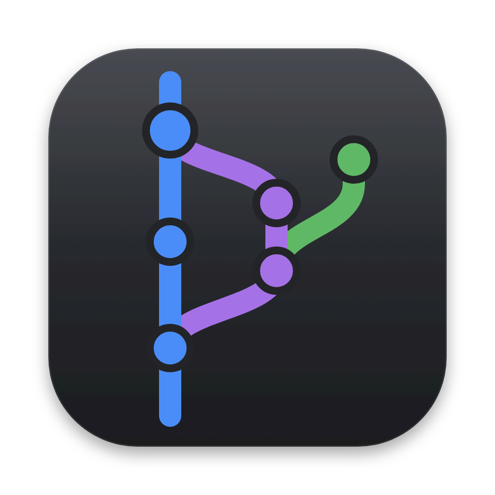

<p align="center"></p>

# Lanes

JetBrains IDE의 Git 툴 윈도우를 본뜬, 빠르고 가벼운 macOS용 독립 실행형 Git 로그 뷰어입니다.
IDE를 열지 않고도 브랜치 트리, 커밋 그래프, 필터, 변경 파일, 좌우 비교 diff 창을 그대로 쓸 수 있습니다.

Tauri 2(Rust) + React + TypeScript로 만들었고, 시스템에 설치된 `git`을 그대로 사용합니다.

## 주요 기능
- **브랜치 트리(LINES)**: 로컬 / 리모트 / 태그, `/` 기준 폴더 묶음, 즐겨찾기. 체크아웃, 새 브랜치, 삭제, 페치, 풀 지원
- **커밋 그래프**: IntelliJ와 같은 레인 배치와 "Standard"(Bek) 정렬. 커밋 10만 개 이상도 부드럽게 표시
- **지하철 노선도 스타일**: 직선과 각진 꺾임, 교차점 외곽선, merge 커밋은 환승역 모양으로 표시
- **브랜치마다 하나의 노선 색**: 한 줄기는 처음부터 끝까지 같은 색. 이름 있는 브랜치끼리는 색이 겹치지 않고, `main`과 `origin/main`은 같은 색. 정렬을 바꾸거나 다시 불러와도 색이 유지됨
- **필터**: 텍스트/해시(정규식, 대소문자 구분), 브랜치, 사용자, 날짜, 경로. 걸러진 히스토리는 점선으로 연결
- **행 높이**: 넓게 / 촘촘하게 (정렬 메뉴에서 선택)
- **커밋 메뉴**: 해시 복사, 리비전 체크아웃, 여기서 새 브랜치
- **변경 사항**: 변경 파일 트리, 커밋 상세, 단어 단위 하이라이트가 있는 별도 좌우 비교 diff 창
- **여러 저장소를 탭으로** 열기, 열었던 탭과 설정 기억, 저장소가 바뀌면 자동 새로 고침

## 단축키
| 동작 | 단축키 |
|---|---|
| 저장소 열기 / 탭 닫기 | ⌘T / ⌘W |
| 탭 이동 | ⌘1–9, Ctrl+Tab |
| 새로 고침 | ⌘R |
| (diff 창) 다음 / 이전 변경 | F7 / ⇧F7 (또는 ⌘↓ / ⌘↑) |
| (diff 창) 이전 / 다음 파일 | ⌘← / ⌘→ |
| (diff 창) 닫기 | Esc 또는 ⌘W |

## 개발
```bash
pnpm install
pnpm tauri dev        # 앱 실행
pnpm test             # TS 단위 테스트 (그래프 엔진, UI 로직, Rust↔TS 계약)
cd src-tauri && cargo test
```
Node 20 이상, pnpm, Rust(stable), Xcode 커맨드라인 도구가 필요합니다.

## 빌드
```bash
pnpm tauri build                                  # 현재 아키텍처용 Lanes.app / .dmg
pnpm tauri build --target universal-apple-darwin  # Apple Silicon + Intel 유니버설 빌드
```
결과물은 `src-tauri/target/<target>/release/bundle/` 아래에 생깁니다.
유니버설 빌드에는 `rustup target add aarch64-apple-darwin x86_64-apple-darwin`이 필요합니다.

### 서명과 공증 (배포용)
`tauri.conf.json`의 `bundle.macOS.signingIdentity`에 Developer ID 인증서를 지정하면 빌드할 때 서명됩니다.
그다음 공증하고 스테이플합니다.
```bash
xcrun notarytool submit Lanes_<ver>_universal.dmg --keychain-profile <프로필> --wait
xcrun stapler staple Lanes_<ver>_universal.dmg
spctl -a -vv -t install Lanes_<ver>_universal.dmg   # Gatekeeper 확인
```
직접 빌드만 해서 쓸 거라면 `signingIdentity`를 지우거나 `"-"`(ad-hoc)로 바꾸면 됩니다.

## 프로젝트 구조
| 경로 | 내용 |
|---|---|
| `src/graph/` | IntelliJ 그래프 엔진 TS 포트 (레인 배치, Bek 정렬, 브랜치 색) |
| `src/ui/` | 메인 창 React UI (브랜치 트리, 로그 표, 필터, 커밋 상세) |
| `src/diffwindow/` | 별도 좌우 비교 diff 창 |
| `src/types.ts` | Rust ↔ TS 공유 계약 (명령, 이벤트, 그래프 타입) |
| `src-tauri/` | Rust 백엔드 (git 실행, 저장소 감시, 상태 저장) |
| `design/` | 앱 아이콘 원본 |

## 라이선스
[Apache License 2.0](LICENSE)을 따릅니다. Copyright 2026 flashrifle.

## 크레딧
커밋 그래프 엔진은 IntelliJ Platform VCS 로그의 일부를 TypeScript로 옮긴 것입니다(Apache License 2.0).
자세한 내용은 [NOTICE](NOTICE)를 참고하세요. Lanes는 JetBrains와 관련이 없는 독립 프로젝트입니다.

번들 폰트 IBM Plex Sans KR, Archivo, JetBrains Mono는 SIL Open Font License 1.1을 따릅니다
([src/assets/fonts/LICENSES.txt](src/assets/fonts/LICENSES.txt)).
